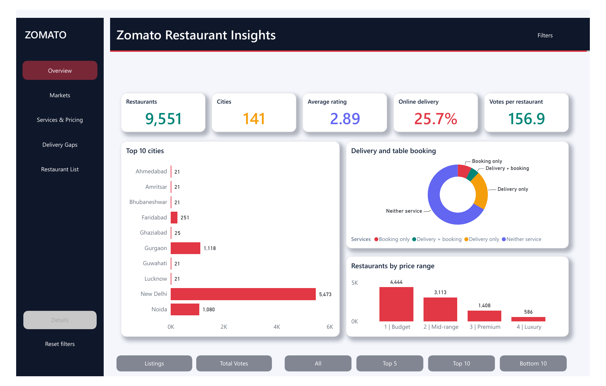

# Zomato Restaurant Insights



A five-page Power BI report exploring restaurant coverage, cuisines, service availability, ratings, and India pricing across 9,551 restaurant listings.

**[Download the dashboard](dashboard/Zomato_Insights.pbix)** · **[DAX measures](dax/measures.dax)** · **[Data dictionary](docs/data-dictionary.md)**

## Report pages

| Page | Questions explored |
| --- | --- |
| Overview | How large is the sample, and how do cuisine reach and service coverage compare? |
| Markets | Which cities dominate the sample, and how do delivery and vote engagement compare with the selected market? |
| Services & Pricing | How do booking, delivery, ratings, and India cost for two vary? |
| Delivery Gaps | Where are restaurants with at least 100 votes that do not offer online delivery? |
| Restaurant List | Which individual listings explain the selected results? |

The report includes country and city filters, contextual chart tooltips, zero-based table data bars, and 43 DAX measures. City benchmark indices respond to the selected market: 1.00 means the city matches that market's average.

## Selected findings

- India accounts for 8,652 of 9,551 listings (90.6%); the sample is heavily concentrated in one country.
- Online delivery is available at 2,451 listings (25.7%).
- Of 2,826 listings with at least 100 votes, 1,762 have no online delivery and 1,064 have delivery.
- North Indian cuisine appears at 3,960 restaurants. Restaurants can belong to several cuisines, so cuisine counts are not additive.
- The median positive cost for two in India is INR 450.

The delivery gap is an exploratory screening measure. Votes indicate observed engagement; these data do not establish unmet demand or forecast revenue.

## Open and refresh

1. Download this repository and open `dashboard/Zomato_Insights.pbix` in Power BI Desktop.
2. The report contains an imported data snapshot and can be viewed without refreshing.
3. To refresh, select **Transform data** and update the CSV file paths in the Source steps for `zomato` and `RestaurantCuisine` to this repository's `data/Restaurants.csv` and `data/RestaurantCuisine.csv`. The saved report currently uses local absolute paths.
4. Keep the CSV encoding as UTF-8 and retain the existing transformations and column types. Apply changes and refresh.

## Model and DAX

`zomato` has one row per restaurant. `RestaurantCuisine` expands the cuisine list to one unique restaurant–cuisine pair per row. A many-to-one relationship on `RestaurantID`, with bidirectional filtering, allows cuisine selections to filter restaurant measures. Restaurant counts use `DISTINCTCOUNT` to avoid duplication.

Measures cover coverage rates, selected-market ranking and benchmarks, engagement, service combinations, and positive-cost India pricing. `DIVIDE` handles ratios with empty denominators; three delivery count measures explicitly return zero when there are no matches. The complete definitions are in `dax/measures.dax`.

## Data and interpretation

This project uses the supplied Zomato workbook and dashboard as its starting material. The two prepared CSVs reproduce the restaurant records used in the report. The original data publication date and redistribution license were not provided; no dataset license is asserted here.

- This is a historical sample of 15 countries and 141 cities, not a current market census.
- Ratings of exactly 1.0 have undocumented meaning and are retained as recorded. They are not relabeled as missing or unrated.
- Zero costs are retained in source data and excluded from measures explicitly named “Positive Cost”.
- Costs use different currencies. INR pricing comparisons are restricted to India; global cost averages would be misleading.
- Missing cuisines use an `Unspecified` bridge category. Cuisine reach is based on distinct restaurant IDs.

See [validation notes](docs/validation.md) for the checks performed and their limits.

## Repository contents

```text
dashboard/Zomato_Insights.pbix   Power BI report with imported data
data/Restaurants.csv            Restaurant table
data/RestaurantCuisine.csv      Restaurant–cuisine bridge
dax/measures.dax                43 measure definitions
docs/                          Data dictionary and validation notes
```

[Report notes](docs/report-notes.md) contain the scope and interpretation details behind the visuals.

## Dashboard controls

The redesigned report adds page navigation, collapsible synchronized filters, metric and ranking views, a contextual tooltip page and a drillthrough detail page. Light and dark themes are included. Display bookmarks preserve filter selections; existing SQL, DAX and imported data are retained. See the [control guide](docs/dashboard-controls.md) and [Power BI source](powerbi/Zomato_Insights.Report).
